# Motion graphics programático

Biblioteca de grafismos animados para vídeos curtos (TikTok, Reels, Shorts e YouTube) em que **cada peça é um comando**. Você passa o texto, os nomes e os números; sai um MP4 pronto para postar, um WebM com fundo transparente para pôr sobre o vídeo, um quadro PNG ou uma folha de checagem com a zona segura do app marcada.

Sem After Effects e sem template manual: a animação é HTML + GSAP, o Chrome sem janela renderiza quadro a quadro e o ffmpeg codifica.

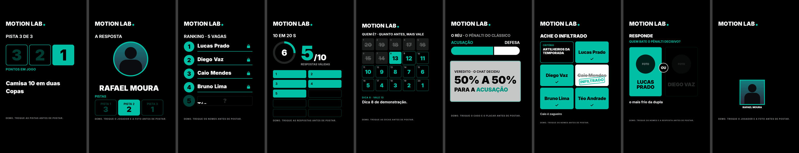

<p>
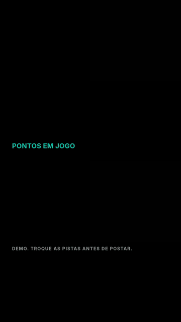
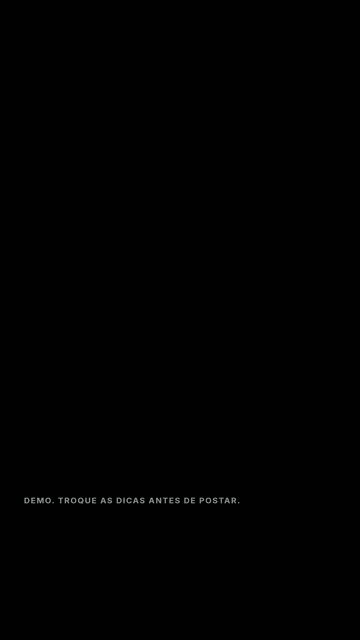
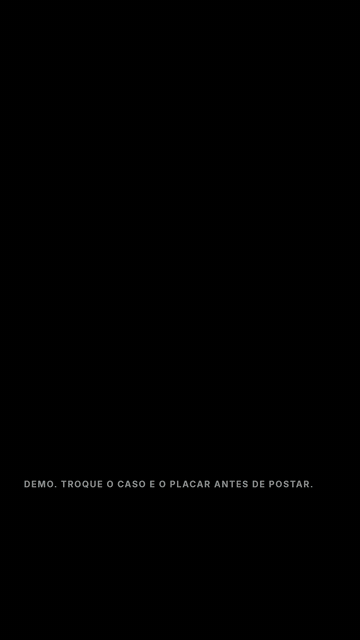
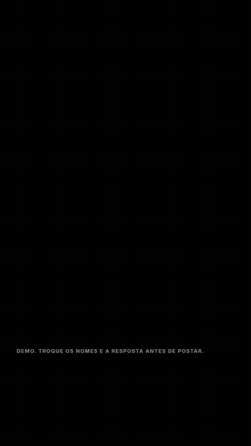
</p>

> A marca "MOTION LAB", a foto e os nomes das demos são fictícios. O projeto original foi feito para um canal de conteúdo de futebol; aqui estão o código e o método, com uma marca de demonstração.

## O problema

Um canal de quadros de futebol (adivinhação por pistas, rankings, "quem é o infiltrado", júri do chat) precisa de grafismos novos **todo dia**, nos formatos 9:16 e 16:9, sempre na identidade visual do canal. Fazer cada um à mão no editor não escala: muda um nome e é preciso reabrir o projeto, reposicionar, exportar e conferir de novo.

## A solução

- **Uma peça = um gerador.** Cada quadro do canal virou um script com parâmetros (`--clues`, `--names`, `--score`, `--pick`…). O layout se adapta sozinho ao texto e ao formato.
- **Renderizador próprio, sem dependências:** [`engine/render_core.py`](engine/render_core.py) abre o Chrome headless, fala com ele pelo DevTools Protocol (cliente WebSocket escrito na biblioteca padrão do Python), posiciona a timeline GSAP no instante exato de cada quadro e captura a tela. O ffmpeg recebe os quadros por pipe.
- **Determinístico por construção:** o tempo nunca vem do relógio; cada quadro é um `seek` na timeline. O [`verify.py`](verify.py) prova isso: renderiza os mesmos instantes em dois navegadores novos, compara os SHA-256 e procura no HTML o que escaparia do seek (`Date.now`, `Math.random`, timers, animação CSS).
- **Pronto para a pós:** WebM VP9 com canal alfa para sobrepor no vídeo, MP4 H.264 em BT.709 e uma folha de contato com a zona segura de 9:16 sombreada (12% no topo, 20% na base e a coluna de botões à direita).
- **Transições no ffmpeg:** [`engine/transicoes.py`](engine/transicoes.py) monta transições com easing (varredura, borda, empurra, flash, abre) como expressões do filtro `xfade`, sem bounce e com um traço na cor de destaque.

## As peças

| # | Peça | O que mostra | Exemplo |
|---|---|---|---|
| 03 | Pista em Queda | Pista de adivinhação e quanto ela vale (3, 2, 1 ponto) | `--clues "pista 1\|pista 2\|pista 3"` |
| 04 | Revelação do Jogador | A resposta e em qual pista alguém acertou | `--player "NOME" --photo foto.png --hit 2` |
| 05 | Escada às Cegas | Ranking montado às cegas, vaga por vaga | `--names "A\|B\|C\|D\|E" --order 3,1,4,2,5` |
| 06 | Relógio 10 em 60 | Quantas respostas válidas cabem no tempo | `--hits 7 --seconds 60` |
| 07 | Grade de Dicas | Em qual de 20 dicas alguém acertou | `--clues "..." --hit 9` |
| 08 | Veredito do Júri | Acusação × defesa, com o placar do chat | `--case "O CASO" --score 62` |
| 09 | Ache o Infiltrado | Qual nome não pertence à lista | `--names "..." --odd 3 --criterion "..."` |
| 10 | Isso ou Aquilo | A escolha entre duas opções | `--a "A" --b "B" --pick a` |
| 11 | Foto Central | Foto em destaque com o nome | `--player "NOME" --photo foto.png` |

<p>
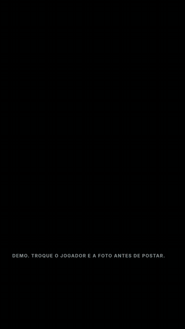
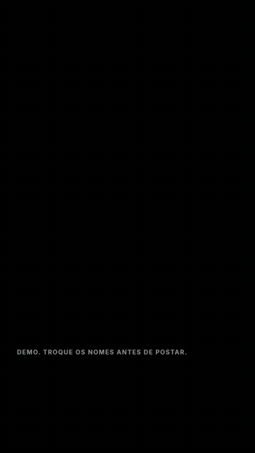
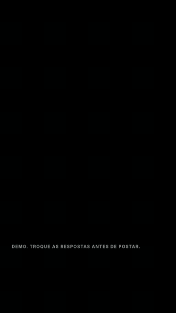
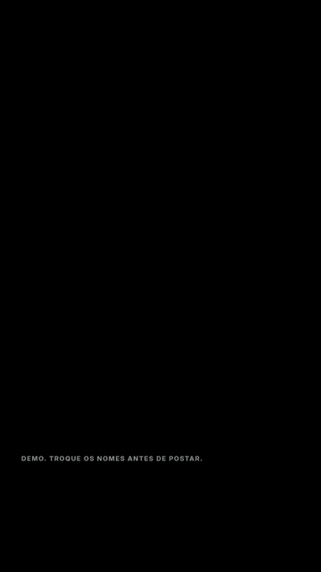
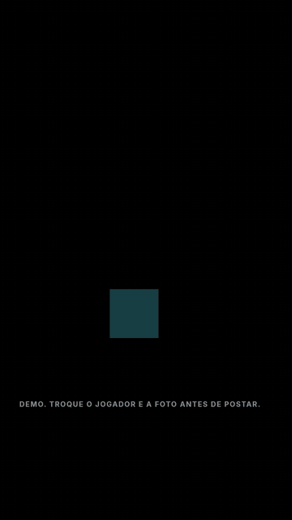
</p>

### Os mesmos geradores em 16:9

<p>
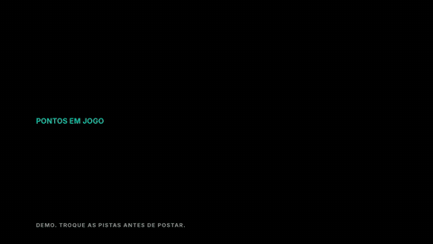
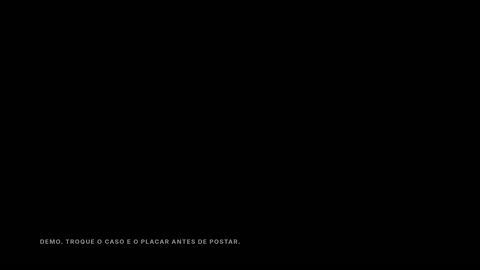
</p>

### Transparente, para pôr sobre o vídeo

O `--kind webm --transparent` gera VP9 com canal alfa, sem o logo, para entrar direto na edição. Abaixo, a peça 03 sobre um fundo em movimento (`python demo.py --overlay`):

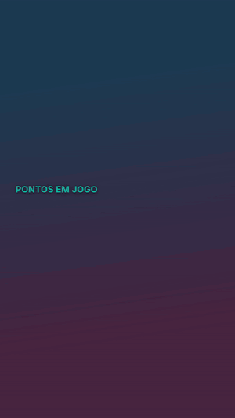

## Como rodar

Requisitos: Python 3.10+, Pillow (só para a folha de checagem), ffmpeg 5+ no PATH e Google Chrome ou Chromium.

```bash
pip install pillow
python assets/brand/make_brand.py          # gera o logo e a foto de demonstração
python demo.py                             # renderiza as 9 demos e os GIFs deste README
```

Uma peça avulsa:

```bash
python pieces/03-pista-em-queda/source/build_pista.py render \
  --clues "Nasceu em 1987|Jogou em três ligas|Camisa 10 em duas Copas" \
  --aspect 9x16 --kind mp4            # ou: webm --transparent | still --at 2.5 | sheet
```

Checagem de determinismo:

```bash
python verify.py all
```

Se o Chrome não for encontrado sozinho, passe `--browser CAMINHO` ou defina `CHROME_PATH`.

## Estrutura

```
engine/render_core.py   Chrome headless + DevTools Protocol, seek e captura (só biblioteca padrão)
engine/transicoes.py    transições com easing via ffmpeg xfade
pieces/NN-nome/source/  gerador de cada peça (HTML + timeline GSAP + CLI)
assets/                 fontes Inter, GSAP e a marca de demonstração
demo.py                 renderiza todas as demos e os GIFs
verify.py               prova de determinismo
```

Para trocar de marca: substitua `assets/brand/logo.png` e a cor de destaque (`P`/`PURPLE` no topo de cada gerador).

## Resultado e minha parte

- **14 vídeos por semana** usam as peças em produção.
- **Cerca de 5 minutos** para testar e implementar uma variante nova (outro texto, outros nomes, outro formato).
- **Aprovação 100% automatizada:** cada ideia de motion virava um cartão com prévia em GIF num portal de aprovação próprio (Looky). Só depois de aprovada e de escolhida uma das opções A/B/C a peça era construída, renderizada e conferida contra o guia de look.

Desenhei os quadros e o sistema: o formato de cada peça, os parâmetros, o pipeline de render, as checagens (zona segura, determinismo) e o fluxo de aprovação. A prova de determinismo pegou um bug real. Uma peça media o texto antes de a fonte carregar, e cada render saía ligeiramente diferente. A correção (medir só depois de `document.fonts.ready`) hoje vale para todas as peças.

## English summary

A library of data-driven motion graphics for short-form video, where every piece is a command-line generator. Animations are HTML + GSAP timelines. A dependency-free Python renderer drives headless Chrome over the DevTools Protocol, seeks the timeline to each frame's exact time and pipes the frames to ffmpeg (H.264 MP4, VP9 WebM with alpha, PNG stills, safe-area contact sheets). `verify.py` proves the renders are deterministic by rendering the same frames in two fresh browsers and comparing SHA-256 hashes. In production the pieces feed 14 videos a week, a new variant takes about 5 minutes to test and ship, and every motion idea went through an automated approval portal before being built.

## Licença

Código sob [MIT](LICENSE). GSAP e a fonte Inter mantêm as licenças próprias (abaixo).

## Créditos

- [GSAP](https://gsap.com) (`assets/vendor/gsap.min.js`), sob a licença padrão da GreenSock/Webflow.
- Fonte [Inter](https://github.com/rsms/inter), de Rasmus Andersson, sob a SIL Open Font License 1.1.
- A ideia de usar easing no `xfade` veio de [scriptituk/xfade-easing](https://github.com/scriptituk/xfade-easing) (MIT). As expressões daqui foram escritas do zero.
